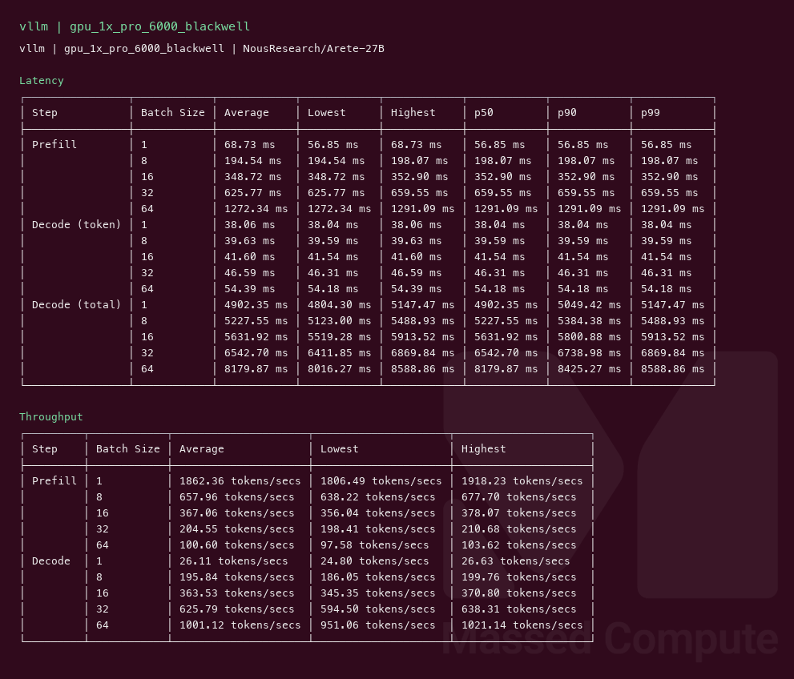
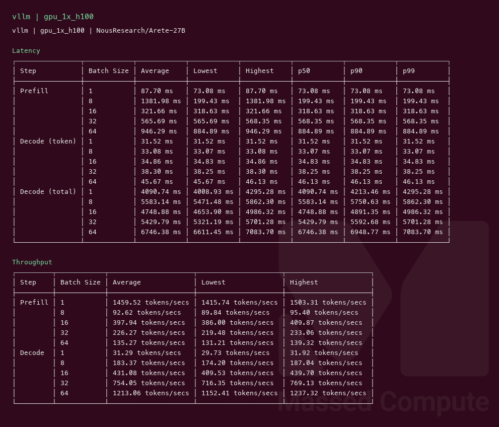

# Arete 27B GPU Benchmark

### Last Edit Date:
MC - 2026.11.09

## Purpose
Arete-27B is Nous Research's supervised fine-tune of Qwen3.8-27B (Apache-2.0, same 27B size, no architecture change). This page measures sustained vLLM output throughput on the exact BF16 weights, then what a more expensive card buys.

## What fits
BF16 weights are about 51 GB on the GPU before the cache. A 48 GB card does not hold them. On 9 Nov 2026 the cheaper in-stock cards (A6000 at $0.57/hr, RTX 6000 Ada at $0.79/hr, L40 at $0.86/hr, L40S at $0.97/hr) were left untested for that reason. The L40S list rate rose to $0.97 on 2026-09-08. Pages that still say $0.88 were captured at the earlier rate. The least expensive live card that ran the model was the 1× A100 at **$1.38/hr**.

## Technique
Random prompts, 128 in, 128 out, request-rate inf. Concurrency 1, 8, 16, 32, and 64. The headline is **output token throughput at concurrency 32**, not the peak figure in the same log.
Engine: **vLLM** `vllm/vllm-openai:v0.27.1` with `--max-model-len 8192`, `--gpu-memory-utilization 0.92`, `--max-num-batched-tokens 16384`, `--kv-cache-dtype fp8`, `--limit-mm-per-prompt '{"image":0}'`, `--reasoning-parser qwen3`. Prefix caching was off.
The A100 kept the server default `max_num_seqs`. Blackwell and the H100 crashed at that default (594 and 333 Mamba cache blocks) and the rows below used `--max-num-seqs 64`. Thirty-two is under 64, so c32 is still a full 32-way run. It is not the same flag as the published Qwen3.8-27B Blackwell row, which left `max_num_seqs` at the default. Read the Blackwell and H100 lines as indicative next to that page.

## Results

| Tier | SKU | $/hr | Output tok/s (c32) | TTFT med (ms) | tok/s per $ | $/1M out tokens |
|---|---|---:|---:|---:|---:|---:|
| Smallest fit | `gpu_1x_DGX_A100` | 1.38 | 613.3 | 961.0 | 444.4 | 0.625 |
| Medium | `gpu_1x_pro_6000_blackwell` | 2.19 | 625.8 | 659.5 | 285.7 | 0.972 |
| Large | `gpu_1x_h100` | 2.73 | 754.0 | 568.4 | 276.2 | 1.006 |

Rates are the live list price on the capture date.

### What more hardware buys
The A100 is the number most people want: **613.3 tok/s** and **444.4 tok/s per dollar**.

Blackwell at $2.19/hr adds about **2%** more output tokens (625.8) and cuts median time-to-first-token from 961 ms to 660 ms. Each token costs more. It is not the value pick.

The H100 at $2.73/hr is **1.2×** the A100 on output tokens (754.0) and the lowest first-token wait (568 ms). It is the speed pick, and the worst of the three on tok/s per dollar.

### Screenshots

**gpu_1x_DGX_A100** — $1.38/hr — smallest fit

vllm — 613.3 output tok/s @ c32:

**gpu_1x_pro_6000_blackwell** — $2.19/hr — medium

vllm — 625.8 output tok/s @ c32:

**gpu_1x_h100** — $2.73/hr — large

vllm — 754.0 output tok/s @ c32:

## Conclusion
Rent the A100 unless first-token wait is the constraint. The H100 is the faster card. Blackwell sits between them on speed and does not win on cost.

---

  

  <strong><a href="https://massedcompute.com/?utm_source=github.com&utm_campaign=gpu-benchmark">LAUNCH GPU OR CPU INSTANCE</a></strong>

> **Pricing note:** Listed `$/hr` rates are point-in-time from the capture date. Confirm live pricing in the marketplace before you launch — rates can change. Pay only for the hours you use.
