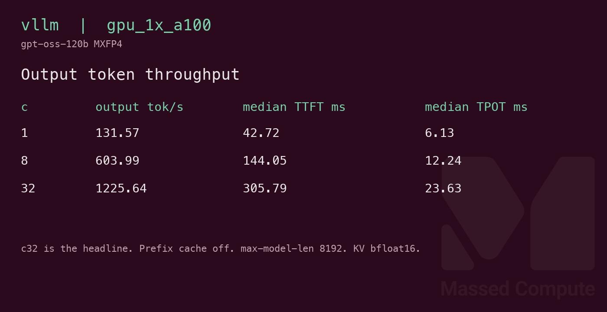
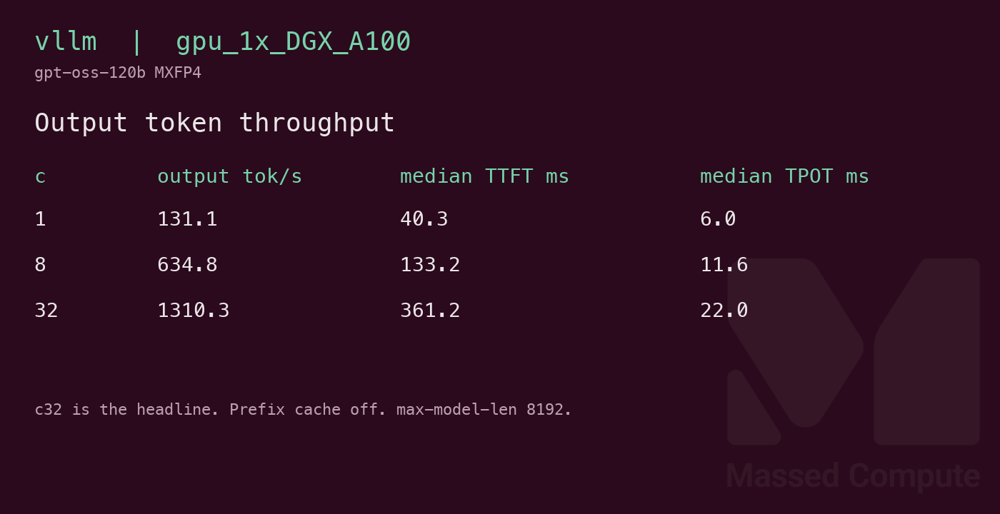

# gpt-oss-120b GPU Benchmark

### Last Edit Date:
MC - 2026.11.17

## Purpose
Live Massed Compute inference bench for **openai/gpt-oss-120b**, the official Apache-2.0 checkpoint. Architecture `GptOssForCausalLM`, native MXFP4 MoE weights. gpt-oss-20b already has a page. This capture is the 120B model.

## What fits
While vLLM was serving, each GPU held 74,591 MiB (72.8 GiB). A 48 GB card does not hold that. On 17 Nov 2026 two 80 GB cards finished this capture, and both were run. `gpu_1x_a100` (A100 80GB PCIe) was **$1.35/hr**. `gpu_1x_DGX_A100` (A100-SXM4-80GB) was **$1.38/hr**. The headline is the PCIe card because it is the less expensive of the two that fit.

RTX 6000 Ada ($0.79/hr), L40 ($0.86/hr), L40S ($0.97/hr; the rate rose from $0.88 to $0.97 on 2026-09-08), and the A6000 ($0.57/hr) were in stock and were not launched. They have 48 GB. `gpu_1x_pro_6000_blackwell` ($2.19/hr) and `gpu_1x_h100` ($2.73/hr) cost more and were not launched.

## Technique
Random prompts, 128 in, 128 out, request-rate inf, `ignore-eos`. Concurrency 1, 8, and 32. The headline is **output token throughput at concurrency 32**, not the peak figure in the same log.
The clock is client wall time against one long-lived server, including HTTP. c1, c8, and c32 share that server. vLLM prints one initial single-prompt test before the timed run; the JSON is the timed run.
Engine: **vLLM** `vllm/vllm-openai:v0.32.0` digest `sha256:befccf0e7e4089aa23926bb6f887a85c0d46c2a99e6de5c5ffdf5cb7957c5b34` (`vllm --version` 0.32.0). Weights pinned to revision `b5c939de8f754692c1647ca79fbf85e8c1e70f8a`.
Serve flags: `--max-model-len 8192`, `--gpu-memory-utilization 0.92`, `--max-num-batched-tokens 16384`, `--kv-cache-dtype bfloat16`, `--attention-backend TRITON_ATTN`. Prefix caching was off.
Both GPUs are Ampere. fp8 KV is not used here; the KV cache is bfloat16. The bench client set `HF_HOME` to a writable directory and passed `--tokenizer /model`.

## Results

| Tier | SKU | $/hr | Output tok/s (c32) | TTFT med (ms) | tok/s per $ | $/1M out tokens |
|---|---|---:|---:|---:|---:|---:|
| Less expensive fit | `gpu_1x_a100` | 1.35 | 1225.6 | 305.8 | 907.9 | 0.306 |
| Second configuration | `gpu_1x_DGX_A100` | 1.38 | 1310.3 | 361.2 | 949.5 | 0.293 |

The rates are the live list prices on 17 Nov 2026. The PCIe rate was confirmed on the instance at launch ($1.35/hr). One decimal is half-up from the bench JSON. PCIe c32 output throughput is 1225.6412351975532 and median TTFT is 305.78613099999075. DGX c32 output throughput is 1310.3326572803944 and median TTFT is 361.1506785000529. tok/s per $ is that one-decimal rate divided by $/hr. $/1M out tokens is `$/hr × 1,000,000 / (tok/s × 3600)` using the one-decimal rate. The PCIe showcase keeps two decimals of that raw JSON (c32 1225.64 on `gpu_1x_a100`). The DGX showcase keeps one decimal (c32 1310.3 on `gpu_1x_DGX_A100`).

`gpu_1x_a100`, same server, other concurrencies (not the headline):

| Concurrency | Output tok/s | TTFT med (ms) |
|---|---:|---:|
| 1 | 131.6 | 42.7 |
| 8 | 604.0 | 144.1 |
| 32 | 1225.6 | 305.8 |

`gpu_1x_DGX_A100`, same server:

| Concurrency | Output tok/s | TTFT med (ms) |
|---|---:|---:|
| 1 | 131.1 | 40.3 |
| 8 | 634.8 | 133.2 |
| 32 | 1310.3 | 361.2 |

### What more hardware buys
The headline stays the less expensive card that fits: **1225.6 tok/s** on `gpu_1x_a100` at $1.35/hr.

`gpu_1x_DGX_A100` at $1.38/hr used the same MXFP4 weights, vLLM image, KV dtype, and serve flags. Its c32 output throughput is **1310.3 tok/s**. Median TTFT at that concurrency is 361.2 ms, slower than the PCIe card's 305.8 ms.

### Screenshots

**gpu_1x_a100** — $1.35/hr — less expensive fit

vllm — 1225.64 output tok/s @ c32:

**gpu_1x_DGX_A100** — $1.38/hr

vllm — 1310.3 output tok/s @ c32:

## Notes
- While vLLM was serving the PCIe bench, `nvidia-smi` showed 74,591 MiB used of 81,920 MiB (72.8 GiB of 80.0 GiB) at 95% utilization. 74,591 / 1024 = 72.8 GiB. The device name on that sample is A100 80GB PCIe. The rented SKU is `gpu_1x_a100`.
- While vLLM was serving the DGX bench, `nvidia-smi` showed 74,591 MiB used of 81,920 MiB (72.8 GiB of 80.0 GiB) at 100% utilization. 74,591 / 1024 = 72.8 GiB. The device name on that sample is A100-SXM4-80GB. The rented SKU is `gpu_1x_DGX_A100`.
- Both `engine.txt` files sum every `*.safetensors` file in the snapshot (130,497,762,984 bytes). The snapshot contains more than one weight layout, so that sum is larger than the set the server loaded.
- `gpu_1x_pro_6000_blackwell` and `gpu_1x_h100` were not run in this capture.

## Conclusion
Both cards were run. The headline is the less expensive card that fits: 1× A100 PCIe (`gpu_1x_a100`) at $1.35/hr served the MXFP4 weights at **1225.6 output tok/s** at concurrency 32. `gpu_1x_DGX_A100` at $1.38/hr served the same weights at **1310.3 output tok/s** at concurrency 32.

---

  

  <strong><a href="https://massedcompute.com/?utm_source=github.com&utm_campaign=gpu-benchmark">LAUNCH GPU OR CPU INSTANCE</a></strong>

> **Pricing note:** Listed `$/hr` rates are point-in-time from the capture date. Confirm live pricing in the marketplace before you launch — rates can change. Pay only for the hours you use.
