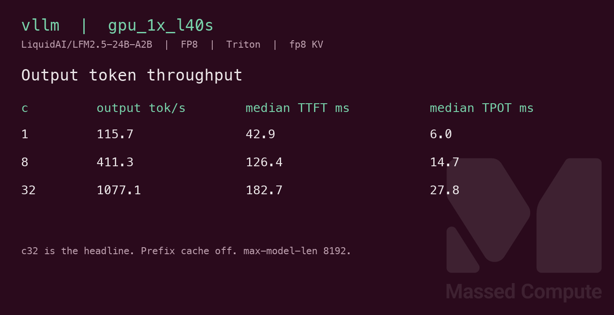
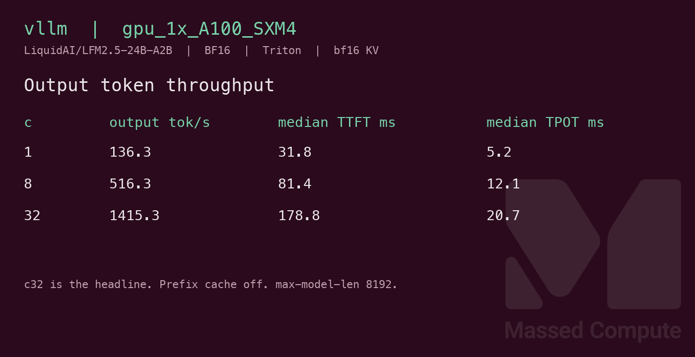
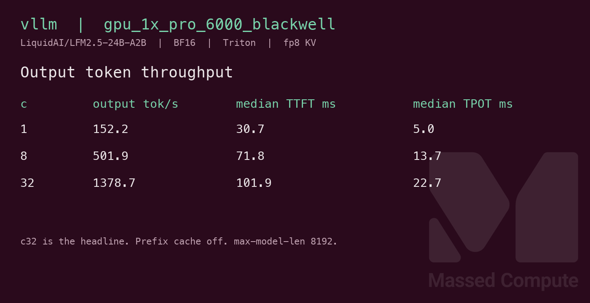

# LFM2.5-24B-A2B GPU Benchmark

### Last Edit Date:
MC - 2026.10.19

## Purpose
Live Massed Compute vLLM benches for [LiquidAI/LFM2.5-24B-A2B](https://huggingface.co/LiquidAI/LFM2.5-24B-A2B) revision `1769516ac588c4c558089c94f27d96b0dc67b183`. Architecture `Lfm2MoeForCausalLM` (`lfm2_moe`). The repo ships no modeling Python, and vLLM 0.32.0 registers that class, so the server does not pass `--trust-remote-code`. Weights are BF16. Measured safetensors are **47,944,143,456** bytes (**44.65 GiB**). `gpu_1x_l40s` serves those weights with online `--quantization fp8`. The A100 and Blackwell rows serve BF16.

## Technique
Pinned profile: `vllm bench serve`, backend openai, `/v1/completions`, random prompts, input=128, output=128, `ignore-eos`, request-rate=inf, concurrency 1 / 8 / 32. Prompts per row are concurrency times 5. Headlines use **c32** **Output token throughput**. The clock is client wall time against one long-lived server, including HTTP.

Engine is vLLM **0.32.0** (torch 2.13.0+cu130, CUDA 13.0). Same weights and revision on every SKU. Prefix cache off. `--max-model-len 8192 --gpu-memory-utilization 0.92 --max-num-batched-tokens 16384`. Tensor parallel is 1. Runner: `scripts/lfm2.5-24b-a2b/remote.sh`.

Attention and KV dtype are not the same on every card. The runner sets them per SKU so a rerun matches the row:

- **L40S** (`gpu_1x_l40s`): forced `--attention-backend TRITON_ATTN`, fp8 KV, and `--quantization fp8`. The first start left the backend unset. vLLM picked FlashInfer, and the prefill JIT died because this image has no nvcc (`serve-attempt1.log`). Triton supports fp8 KV on SM89, so the published row forces Triton.
- **A100 SXM4**: forced `--attention-backend TRITON_ATTN` and **bfloat16 KV**. A100 (SM80) cannot store fp8 KV with Triton (needs SM89) or FlashAttention (fp8 KV needs FA3 on SM90 or FA4 on SM100), and FlashInfer’s attention JIT needs nvcc, which this image does not ship.
- **RTX PRO 6000 Blackwell**: forced `--attention-backend TRITON_ATTN` and fp8 KV. Blackwell has no FlashAttention candidate, and the FlashInfer XQA kernel is missing.

The L40S row is online FP8. The other two rows are BF16 weights with different KV dtypes. Treat cross-SKU tok/s as indicative, not an A/B of one kernel.

## Results

| Engine | SKU | Quant/KV | Attention | $/hr | Output tok/s (c32) | TTFT med (ms) | tok/s per $ | $/1M out tokens |
|---|---|---|---|---:|---:|---:|---:|---:|
| vllm 0.32.0 | `gpu_1x_l40s` | fp8 / fp8 | Triton (forced) | 0.97 | 1077.1 | 182.7 | 1110.4 | 0.250 |
| vllm 0.32.0 | `gpu_1x_A100_SXM4` | bf16 / bf16 | Triton (forced) | 1.38 | 1415.3 | 178.8 | 1025.6 | 0.271 |
| vllm 0.32.0 | `gpu_1x_pro_6000_blackwell` | bf16 / fp8 | Triton (forced) | 2.19 | 1378.7 | 101.9 | 629.5 | 0.441 |

`$/hr` is the live list rate on 2026-10-19. tok/s per $ is c32 output tok/s divided by `$/hr`. `$/1M` is `$/hr × 1,000,000 / (output tok/s × 3600)`. Derived columns use the c32 rate rounded to one decimal, the same figure in the table.

### Screenshots

Serving-bench cards from the raw JSON (input=128, output=128, concurrency 1/8/32).

**gpu_1x_l40s** — L40S 48GB — $0.97/hr

vLLM · Triton (forced) · online FP8 · fp8 KV · c32 **1077.1** output tok/s · TTFT med **182.7** ms:

**gpu_1x_A100_SXM4** — 1× A100 SXM4 80GB — $1.38/hr

vLLM · Triton (forced) · BF16 · bf16 KV · c32 **1415.3** output tok/s · TTFT med **178.8** ms:

**gpu_1x_pro_6000_blackwell** — RTX PRO 6000 Blackwell 96GB — $2.19/hr

vLLM · Triton (forced) · BF16 · fp8 KV · c32 **1378.7** output tok/s · TTFT med **101.9** ms:

## Conclusion

Yes. A single 48GB L40S holds this model when the BF16 checkpoint is served with online FP8. That is the least expensive launched card, at **$0.97/hr**. Its c32 output throughput is **1077.1** tok/s, **1110.4** tok/s per $, **$0.250** per 1M output tokens.

Against the BF16 rows, that FP8 L40S is the value high and the throughput low. `gpu_1x_A100_SXM4` at **$1.38/hr** is the c32 throughput high in this set: **1415.3** tok/s (**1025.6** tok/s per $, **$0.271** per 1M). Blackwell at **$2.19/hr** landed at **1378.7** tok/s and the lowest median TTFT, **101.9** ms (**629.5** tok/s per $, **$0.441** per 1M). Those three rows do not share quantization or KV dtype, so the gaps are indicative.

Concurrency 1 output tok/s: L40S **115.7**, A100 **136.3**, Blackwell **152.2**. Each c32 row completed 160 prompts and failed 0.

## Notes
- `nvidia-smi` memory.used while the server was up, divided by 1024: L40S **41.12 GiB** of **44.99 GiB**, A100 **73.36 GiB** of **80.00 GiB**, Blackwell **87.60 GiB** of **95.59 GiB**.
- L40S `serve-attempt1.log` is the failed first start (FlashInfer prefill JIT, no nvcc), not a shorter-context retry. The published L40S row forced Triton and ran at `--max-model-len 8192`.
- Cheaper 48GB cards were in stock on 2026-10-19 and were not launched: `gpu_1x_a6000` **$0.57/hr**, `gpu_1x_a6000_low_ram` **$0.55/hr**, `gpu_1x_l40` **$0.86/hr**, `gpu_1x_6000_ada` **$0.79/hr**. `gpu_1x_a100` at **$1.35/hr** had no capacity. L40S list rate has been **$0.97** since 2026-09-08.
- Numbers from live Massed runs 2026-10-19; bench VMs terminated after capture.

---

 

 <strong><a href="https://massedcompute.com/?utm_source=github.com&utm_campaign=gpu-benchmark">LAUNCH GPU OR CPU INSTANCE</a></strong>

> **Pricing note:** Listed `$/hr` rates are point-in-time from the capture date. Confirm live pricing in the marketplace before you launch — rates can change. Pay only for the hours you use.
