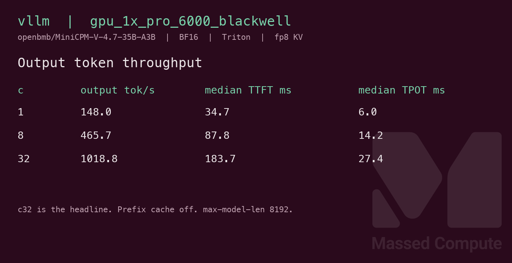

# MiniCPM-V-4.7-35B-A3B GPU Benchmark

### Last Edit Date:
MC - 2026.10.21

## Purpose
Live Massed Compute vLLM benches for [openbmb/MiniCPM-V-4.7-35B-A3B](https://huggingface.co/openbmb/MiniCPM-V-4.7-35B-A3B) revision `896c2d454672476a7b45dcc5e3f0c700a0218577`. Architecture `MiniCPMV4_7ForConditionalGeneration` (`minicpmv4_7`). The repo ships no modeling Python, and vLLM 0.32.0 registers that class, so the server does not pass `--trust-remote-code`. Weights are BF16. Measured safetensors are **70,425,903,448** bytes (**65.59 GiB**). The timed requests are text completions. The server is started with `--limit-mm-per-prompt '{"image": 1}'` so the multimodal loader stays on the path this page credits. This caps images but leaves video enabled. The logs show an encoder-cache budget of **16384 tokens**, profiled with **two maximum-size video items**, even though the timed requests are text completions.

## Technique
Pinned profile: `vllm bench serve`, backend openai, `/v1/completions`, random prompts, input=128, output=128, `ignore-eos`, request-rate=inf, concurrency 1 / 8 / 32. Prompts per row are concurrency times 5. Headlines use **c32** **Output token throughput**. The clock is client wall time against one long-lived server, including HTTP.

Engine is vLLM **0.32.0** (torch 2.13.0+cu130, CUDA 13.0). Prefix cache off. `--max-model-len 8192 --gpu-memory-utilization 0.92 --max-num-batched-tokens 16384`. Tensor parallel is 1. Runner: `scripts/minicpm-v-4.7-35b-a3b/remote.sh`.

Only one SKU completed this profile. Blackwell is forced to `--attention-backend TRITON_ATTN` with fp8 KV for decoder attention. The vision encoder on that same capture still uses `FLASH_ATTN`. Blackwell has no FlashAttention candidate for the decoder, and the FlashInfer XQA kernel is missing. A100 was forced to Triton with bfloat16 KV, because SM80 cannot store fp8 KV on Triton or FlashAttention and FlashInfer’s JIT needs nvcc. H100 was forced to `FLASH_ATTN` with fp8 KV so the decoder would use FA3 instead of the FlashInfer JIT.

## Results

| Engine | SKU | Quant/KV | Attention | $/hr | Output tok/s (c32) | TTFT med (ms) | tok/s per $ | $/1M out tokens |
|---|---|---|---|---:|---:|---:|---:|---:|
| vllm 0.32.0 | `gpu_1x_pro_6000_blackwell` | bf16 / fp8 | Triton (forced) | 2.19 | 1018.8 | 183.7 | 465.2 | 0.597 |

`$/hr` is the live list rate on 2026-10-19. tok/s per $ is c32 output tok/s divided by `$/hr`. `$/1M` is `$/hr × 1,000,000 / (output tok/s × 3600)`. Derived columns use the c32 rate rounded to one decimal, the same figure in the table.

### Screenshots

Serving-bench card from the raw JSON (input=128, output=128, concurrency 1/8/32).

**gpu_1x_pro_6000_blackwell** — RTX PRO 6000 Blackwell 96GB — $2.19/hr

vLLM · Triton (forced) · BF16 · fp8 KV · c32 **1018.8** output tok/s · TTFT med **183.7** ms:

## Conclusion

**`gpu_1x_pro_6000_blackwell`** (96GB) at **$2.19/hr** is the only launched card that held this model on the tested 8192-token profile. That profile left video enabled and reserved encoder capacity for two maximum-size video items. Its c32 output throughput is **1018.8** tok/s, **465.2** tok/s per $, **$0.597** per 1M output tokens. The **$1.38/hr A100** was not tested with `--limit-mm-per-prompt '{"image":1,"video":0}'`. `gpu_1x_h100_nvl` (94GB) at **$3.11/hr** was in stock and was not launched. These captures leave the image-only profile and that 94GB card untested.

Both launched 80GB cards failed the same way before the bench. Each log records `Model loading took 65.65 GiB`. Allocator OOM warnings start once encoder profiling begins, before the KV budget is computed. Available KV memory is then **-3.38 GiB** on `gpu_1x_A100_SXM4` (bf16 KV) and **-2.51 GiB** on `gpu_1x_h100` at **$2.73/hr** (FlashAttention, fp8 KV). Both exit with `ValueError: No available memory for the cache blocks`. Those OOM warnings are not from allocating KV. With a negative KV budget, a shorter `--max-model-len` is not the retry these logs point at. The 16384 batched-token/encoder budget and `--gpu-memory-utilization 0.92` were not retried. There is no completed 80GB row to set beside Blackwell. Blackwell is the only finished capture, so it is also the throughput and value figure for this page.

Concurrency 1 output tok/s on Blackwell: **148.0**. The c32 row completed 160 prompts and failed 0.

## Notes
- `nvidia-smi` memory.used on Blackwell while the server was up, divided by 1024: **82.78 GiB** of **95.59 GiB**.
- `gpu_1x_A100_SXM4` did not write `DONE`. Same failure as `gpu_1x_h100`: `Model loading took 65.65 GiB`, allocator OOM warnings once encoder profiling starts, available KV memory **-3.38 GiB**, then `ValueError: No available memory for the cache blocks`. The OOM warnings come before the KV budget and are not a KV allocation. The 16384 encoder budget and `--gpu-memory-utilization 0.92` were not retried. The caching allocator’s device total was **85,093,777,408** bytes. Failure log: `results/raw/minicpm-v-4.7-35b-a3b/gpu_1x_A100_SXM4/bf16-vllm-oom/serve-attempt1.log`.
- `gpu_1x_h100` did not write `DONE`. Same failure as the A100: `Model loading took 65.65 GiB`, allocator OOM warnings once encoder profiling starts, available KV memory **-2.51 GiB**, then `ValueError: No available memory for the cache blocks`. The OOM warnings come before the KV budget and are not a KV allocation. The 16384 encoder budget and `--gpu-memory-utilization 0.92` were not retried. The allocator device total was **85,017,493,504** bytes. Failure log: `results/raw/minicpm-v-4.7-35b-a3b/gpu_1x_h100/bf16-vllm-oom/serve-attempt1.log`.
- 48GB cards were not launched. `gpu_1x_h100_nvl` at **$3.11/hr** was in stock and was not launched. `gpu_1x_h200_nvl` had no capacity.
- Numbers from live Massed runs 2026-10-19; bench VMs terminated after capture.

---

  

  <strong><a href="https://massedcompute.com/?utm_source=github.com&utm_campaign=gpu-benchmark">LAUNCH GPU OR CPU INSTANCE</a></strong>

> **Pricing note:** Listed `$/hr` rates are point-in-time from the capture date. Confirm live pricing in the marketplace before you launch — rates can change. Pay only for the hours you use.
