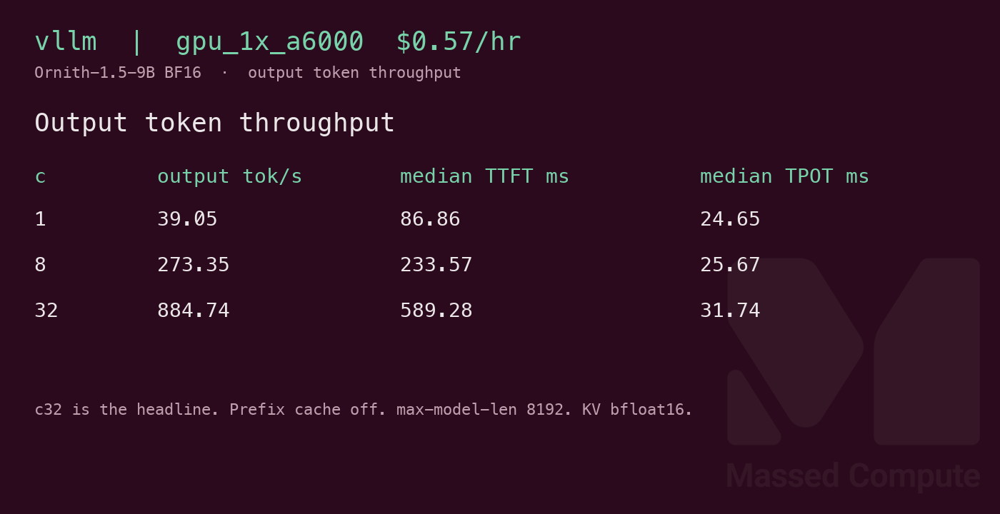

# Ornith 1.5 9B GPU Benchmark

### Last Edit Date:
MC - 2026.11.17

## Purpose
Live Massed Compute inference bench for **ornith-ai/Ornith-1.5-9B**, the safetensors repo (not the GGUF twin). Qwen3.5 dense weights, about 9.7B parameters, BF16, MIT. Ornith 1.0 9B and 35B already have pages. This capture is the 1.5 release on the least expensive 48 GB card that was launched.

## What fits
The safetensors files are 19,306,303,864 bytes (19.3 GB). A 24 GB card does not leave room for that plus the KV cache at 8,192 tokens. On 17 Nov 2026 the live list had `gpu_1x_a6000` at **$0.57/hr** (48 GB VRAM, 48 GB system RAM) with capacity. That is the card this page measures.

`gpu_1x_a6000_low_ram` was less expensive at $0.55/hr and was not launched: it has the same 48 GB of VRAM but only 32 GB of system RAM. RTX 6000 Ada ($0.79/hr), L40 ($0.86/hr), and L40S ($0.97/hr; the rate rose from $0.88 to $0.97 on 2026-09-08) were in stock and were not launched. They cost more than this A6000. A 32 GB RTX PRO 4500 Blackwell was $0.92/hr, also more than this A6000, and was not launched.

## Technique
Random prompts, 128 in, 128 out, request-rate inf, `ignore-eos`. Concurrency 1, 8, and 32. The headline is **output token throughput at concurrency 32**, not the peak figure in the same log.
The clock is client wall time against one long-lived server, including HTTP. c1, c8, and c32 share that server. vLLM prints one initial single-prompt test before the timed run; the JSON is the timed run.
Engine: **vLLM** `vllm/vllm-openai:v0.32.0` digest `sha256:befccf0e7e4089aa23926bb6f887a85c0d46c2a99e6de5c5ffdf5cb7957c5b34` (`vllm --version` 0.32.0). Weights pinned to revision `489cb97981b8654bcfcf30ce1f94ed1b62e07b53`.
Serve flags: `--max-model-len 8192`, `--gpu-memory-utilization 0.92`, `--max-num-batched-tokens 16384`, `--kv-cache-dtype bfloat16`, `--attention-backend TRITON_ATTN`, `--limit-mm-per-prompt '{"image":0}'`, `--reasoning-parser qwen3`. Prefix caching was off.
This GPU is Ampere. fp8 KV is not used here; the KV cache is bfloat16. The bench client set `HF_HOME=/tmp/hfhome` and `HF_HUB_CACHE=/tmp/hfhome/hub` because the hub cache mount was read-only. The bench JSON `tokenizer_id` for this capture is `ornith-ai/Ornith-1.5-9B`.

## Results

| Tier | SKU | $/hr | Output tok/s (c32) | TTFT med (ms) | tok/s per $ | $/1M out tokens |
|---|---|---:|---:|---:|---:|---:|
| Smallest fit launched | `gpu_1x_a6000` | 0.57 | 884.74 | 589.28 | 1552.2 | 0.179 |

The rate is the live list price on 17 Nov 2026. Throughput and median TTFT are two decimals, half-up from the bench JSON, and they match the showcase: c1 39.05, c8 273.35, c32 884.74. Raw c32 output throughput is 884.7430852434575 tok/s. Raw c32 median TTFT is 589.2798299998958 ms. tok/s per $ is that raw c32 throughput divided by $/hr, then one decimal. $/1M out tokens is `$/hr × 1,000,000 / (raw tok/s × 3600)`.

Same server, other concurrencies (not the headline):

| Concurrency | Output tok/s | TTFT med (ms) |
|---|---:|---:|
| 1 | 39.05 | 86.86 |
| 8 | 273.35 | 233.57 |
| 32 | 884.74 | 589.28 |

### Screenshots

**gpu_1x_a6000** — $0.57/hr — smallest fit launched

vllm — 884.74 output tok/s @ c32:

## Notes
- While vLLM was serving the bench, `nvidia-smi` showed 43,250 MiB used of 49,140 MiB (42.2 GiB of 48.0 GiB) at 100% utilization. 43,250 / 1024 = 42.2 GiB.
- Medium and large cards were not run in this capture.
- `gpu_1x_a6000_low_ram` at $0.55/hr was not tested.

## Conclusion
On this run, 1× A6000 at $0.57/hr served the BF16 weights at **884.74 output tok/s** at concurrency 32.

---

  

  <strong><a href="https://massedcompute.com/?utm_source=github.com&utm_campaign=gpu-benchmark">LAUNCH GPU OR CPU INSTANCE</a></strong>

> **Pricing note:** Listed `$/hr` rates are point-in-time from the capture date. Confirm live pricing in the marketplace before you launch — rates can change. Pay only for the hours you use.
