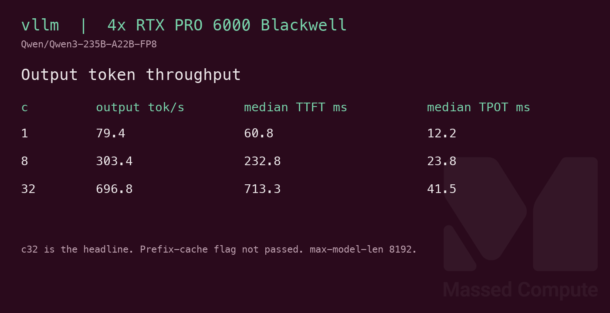

# Qwen3-235B-A22B-FP8 GPU Benchmark

### Last Edit Date:
MC - 2026.10.28

## Purpose
Live Massed Compute vLLM bench for **Qwen3-235B-A22B** official FP8 ([Qwen/Qwen3-235B-A22B-FP8](https://huggingface.co/Qwen/Qwen3-235B-A22B-FP8)), 235B total / 22B active, Apache-2.0. Captured 2026-10-27 on 4× RTX PRO 6000 Blackwell. The runner did not pass `revision=`, so this page does not pin a hub commit. The bench VM was terminated after the raw JSON was copied off.

## Technique
Pinned profile: random prompts, input=128, output=128, request-rate=inf, concurrency 1 / 8 / 32. The headline is **Output token throughput** at concurrency 32.
Engine: **vLLM** `vllm/vllm-openai:v0.27.1` (`sha256:0a51ea5b4ae2dc5d81890e5173f54203d2a3ae0cfffe51b8fd2afd4391bfd967`).
Serve: `--tensor-parallel-size 4 --max-model-len 8192 --gpu-memory-utilization 0.92 --max-num-batched-tokens 16384 --kv-cache-dtype fp8 --moe-backend triton --trust-remote-code`. `VLLM_USE_DEEP_GEMM=0` and `VLLM_MOE_USE_DEEP_GEMM=0`. The runner did not pass `--no-enable-prefix-caching` or `--ignore-eos`. vLLM V1 may enable prefix caching by default. Prompts were random with `random_prefix_len` 0. Every request still returned 128 output tokens (640 / 5120 / 20480). The clock is `vllm bench serve` on `/v1/completions` after the server is up, so it does not include weight download or process start.

DeepGEMM rejected this checkpoint’s FP8 scale layout on these GPUs (`Unknown SF transformation`). The published run is the Triton MoE path.

## Results

| Engine | SKU | Weights | $/hr | Output tok/s (c32) | TTFT med (ms) | tok/s per $ | $/1M out tokens |
|---|---|---|---:|---:|---:|---:|---:|
| vllm | `gpu_4x_pro_6000_blackwell` | FP8 | 8.76 | 696.8 | 713.3 | 79.5 | 3.492 |

| Concurrency | Requests | Output tok/s | TTFT med (ms) |
|---:|---:|---:|---:|
| 1 | 5/5 | 79.4 | 60.8 |
| 8 | 40/40 | 303.4 | 232.8 |
| 32 | 160/160 | 696.8 | 713.3 |

Zero failed requests. During concurrency 32, `nvidia-smi` sampled all four GPUs, utilization reached 100%, and the busiest GPU held **89.1 GiB** of 95.6 GiB.

### Screenshots

**gpu_4x_pro_6000_blackwell** — $8.76/hr — official FP8

vllm — 696.8 output tok/s @ c32:

## Conclusion

4× RTX PRO 6000 Blackwell at **$8.76/hr** served the official FP8 checkpoint at **696.8** output tok/s (concurrency 32), **79.5** tok/s per dollar-hour.

## Notes
- 2× Blackwell (192 GB) and 2× H100 (160 GB) cannot hold the 239 GB FP8 weights. They were not launched. 8× A6000 is less expensive and was not launched: that SKU has no FP8 tensor cores, so this checkpoint was not treated as a fit.
- Same box and engine as the MiniMax-M2.5 page. Different weights, so that pair is not a controlled comparison.
- Capture 2026-10-27. Rate **$8.76/hr** is the live `gpu_4x_pro_6000_blackwell` price that day.
- `nvidia-smi.txt` is the concurrency-32 sample, not a second capture.

---

  

  <strong><a href="https://massedcompute.com/?utm_source=github.com&utm_campaign=gpu-benchmark">LAUNCH GPU OR CPU INSTANCE</a></strong>

> **Pricing note:** Listed `$/hr` rates are point-in-time from the capture date. Confirm live pricing in the marketplace before you launch — rates can change. Pay only for the hours you use.
